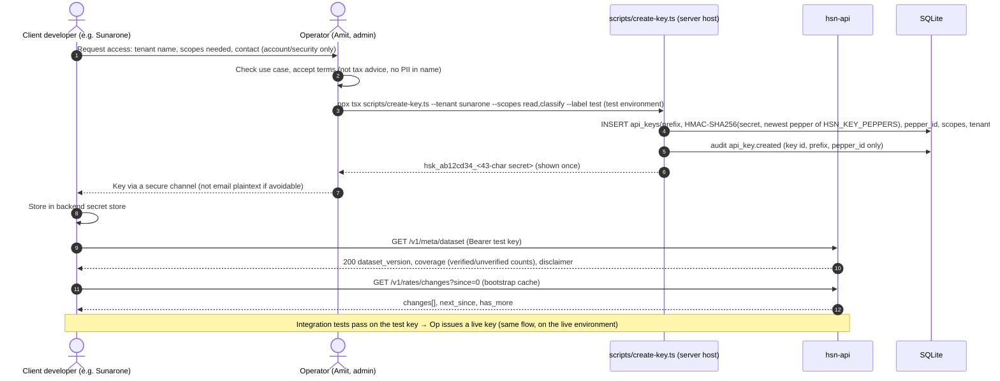
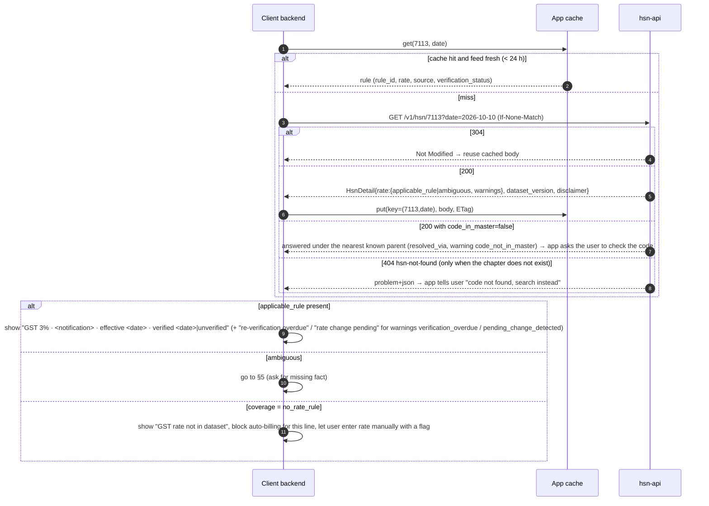
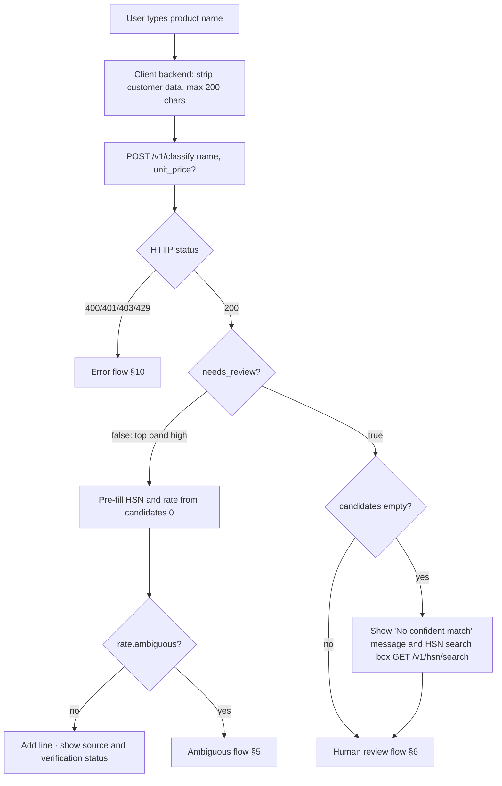
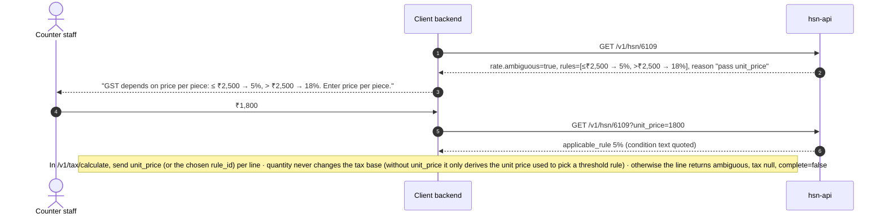
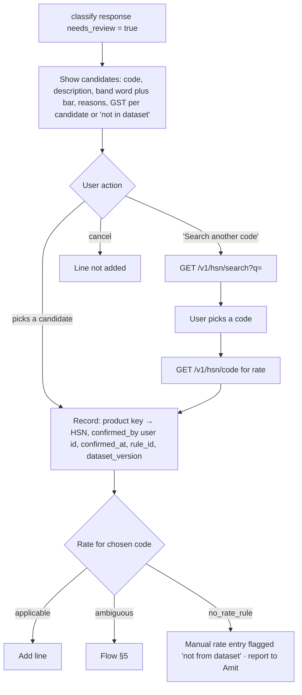
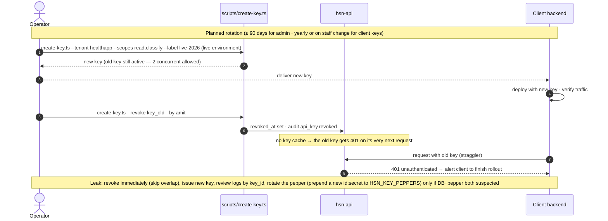
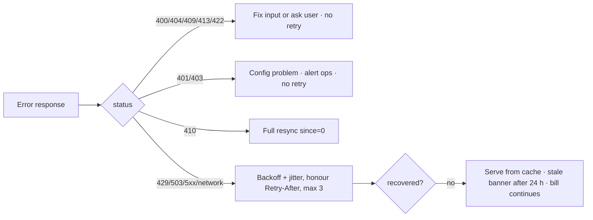

# 03 — Application Flows (HSN Rate API)

Status: draft, walkthroughs re-run against the live server · Date: 2026-10-11 · Requirements: `01-PRD.md` · Technical: `02-TRD.md`
Internal sequences (plugins, services, repositories) are in `design/architecture.md` §2. This document shows **end-to-end flows across client app, API and humans**, including the error paths.

> **Live outputs (validator R5).** Every "Live" block below is a real response, trimmed to the fields that matter, captured on 2026-10-11 from a server started with the quick start in `server/README.md` (fresh copy, `npm run seed`, dataset `2026.10.11-1`, classifier `rules-fts-2.3`, barcode adapters off, LLM off). Rule ids are the deterministic seed ids, so the same seed gives the same ids; request ids, timestamps and `feed_epoch` differ per run. **Every rate in the shipped seed is `unverified`** (transcribed from secondary sources; each rule's `citation_note` says what has not been checked). The mermaid diagrams stay schematic. The admin walkthrough in §8 is illustrative content (a made-up notification `21/2026-CT(Rate)` and PDF hash) run through the real admin API.

Every flow assumes the client calls the API **from its own backend**. Keys never go into a browser or mobile bundle.

---

## 1. Client onboarding and key issuance



Rules: separate `test` and `live` keys (issued by separate environments, each with its own DB and pepper; the key string itself carries no environment marker); scopes are as narrow as possible (`read` for a billing-only backend; add `classify` only where name or barcode detection is used).

**Admin keys (00c ruling 17).** An admin key holds only the `admin` scope, is bound to one admin actor (`actor_id`), expires within 90 days and works only on the admin listener (`127.0.0.1:3001`, reached over SSH/VPN). The first two actors (e.g. Amit and the second reviewer) are created by `scripts/bootstrap-admins.ts` in one run. After that, a new admin actor or admin key needs an `admin_grant` proposal approved by a *different* admin actor:

```mermaid
sequenceDiagram
  autonumber
  actor A as Admin actor A (proposer)
  actor B as Admin actor B (checker)
  participant ADM as hsn-api admin listener
  participant CLI as scripts/create-key.ts (server host)
  A->>ADM: POST /v1/admin/rate-proposals {action:"admin_grant", grant:{handle:"priya", new_actor:false}}  (new_actor:true creates the actor, 00c ruling 35)
  Note over A,B: no out-of-band notice in v1 (00c ruling 29): A tells B; B sees it in GET /v1/admin/rate-proposals
  B->>ADM: GET …/{id} → content_sha256 · POST …/approve {expected_sha256} (Idempotency-Key)
  ADM->>ADM: audit · warn log admin.grant_approved {alert: true}
  A->>CLI: create-key.ts --tenant internal --scopes admin --actor <handle> --grant rp_… (consumes the grant once)
  CLI-->>A: hsk_… (shown once) · audit api_key.created
```

## 2. Lookup by HSN



**Live: `GET /v1/hsn/7113?date=2026-10-11`** (200; `ETag: W/"ds-2026.10.11-1-cd68ff0b577dacb2"`, `Cache-Control: private, max-age=3600, must-revalidate`; the same request with `If-None-Match` → 304):
```json
{"code":"7113","description":"Articles of jewellery and parts thereof, of precious metal or of metal clad with precious metal",
 "level":4,"code_in_master":true,"resolved_via":null,
 "rate":{"as_of":"2026-10-11","coverage":"ok","warnings":["rate_unverified"],"matched_at_level":4,"default_rule_id":null,
   "applicable_rule":{"rule_id":"rr_E1ZB3AQE2ESK0YWX5EJKQ6SZ4P","igst_rate_bp":300,"igst_rate_percent":3,"cgst_rate_percent":1.5,"sgst_rate_percent":1.5,
     "effective_from":"2025-09-22","verification_status":"unverified",
     "source":{"notification":"9/2025-CT(Rate), Schedule IV","url":"https://taxinformation.cbic.gov.in/view-pdf/1010436/ENG/Notifications","pdf_sha256":null,"schedule_serial":null},
     "citation_note":"Transcribed from secondary sources; schedule S.No. and gazette text not yet checked against the CBIC PDF. 9/2025-Central Tax (Rate) dt 17-09-2025, w.e.f. 22-09-2025 (and IGST (Rate) notification of the same number)."}},
 "dataset_version":"2026.10.11-1"}
```
The app shows "GST 3% · 9/2025-CT(Rate), Schedule IV · from 22-09-2025 · **unverified**" and the `citation_note`.

**Live: a code outside the master, `GET /v1/hsn/7199`** (200, round 5 R3):
```json
{"code":"7199","description":"7199 is not in the HSN master; shown under 71: Natural or cultured pearls, precious or semi-precious stones, …",
 "code_in_master":false,"resolved_via":"71",
 "rate":{"coverage":"no_rate_rule","warnings":["no_rate_rule","code_not_in_master"],"matched_at_level":null}}
```
**Live: a code whose chapter does not exist, `GET /v1/hsn/0012`** → 404 `hsn-not-found`, `"detail":"No HSN/SAC \"0012\" in dataset 2026.10.11-1, and chapter 00 does not exist. Try GET /v1/hsn/search?q=…."`.

**Live: `GET /v1/meta/dataset`** (trimmed): `"dataset_version":"2026.10.11-1"`, `"last_change_seq":437`, `"coverage":{"hsn_codes":320,"sac_codes":36,"rate_rules_active":70,"rate_rules_verified":0,"rate_rules_unverified":70,"rate_rules_verification_overdue":0,"hsn_chapters_with_rules":22,"codes_without_rules":148}`, `"classifier":{"llm_configured":false,"external_lookups":[]}`. Since core round 9 the response also lists `known_data_gaps` (from `data/seed/known_gaps.json`), e.g. `{"prefix":"7104","kind":"disputed","reason":"Synthetic / lab-grown stones: sources disagree (0.25% vs 1.5%); no rule seeded."}` and `{"prefix":"3004","kind":"not_transcribed",…}`: a code listed there is "not yet curated", not "no rate exists". Each `sources[]` entry also says how many in-force rules cite it and how many are verified, e.g. `{"notification":"10/2025-CT(Rate)","url":"https://cbic-gst.gov.in/central-tax-rate.html","rule_count":3,"verified_count":0}` (core round 10). `GET /v1/rates/changes?since=0&limit=3` → `hsn_added` rows 1–3, `"next_since":3,"has_more":true`.

## 3. Classify by product name



Weak matches: candidates below 0.10 are dropped. If the best remaining one is below 0.30, the API still returns the rest, all band `low`, with `needs_review: true` and a `message`; the app shows them as options under the message, never as the answer. If the top two are within 0.10, the top is capped at medium (`close_runner_up`), so the review flow runs.

**Live: Sunarone, `POST /v1/classify {"name":"22K gold ring","unit_price":68500.00}`** (trimmed):
```json
{"needs_review":false,"message":null,"classifier":{"version":"rules-fts-2.3"},
 "candidates":[
  {"hsn":"7113","confidence":0.86,"confidence_band":"high",
   "reasons":["synonym_exact","fts_match","chapter_keyword",
     "review_hint: Generic jewellery word: precious-metal jewellery is 7113 (3%); imitation jewellery is 7117 and glass bangles 7018 - confirm the metal."],
   "rate":{"coverage":"ok","warnings":["rate_unverified"],"applicable_rule":{"igst_rate_percent":3}}},
  {"hsn":"7108","confidence":0.32,"confidence_band":"low","reasons":["fts_match","chapter_keyword"]},
  {"hsn":"7106","confidence":0.28,"confidence_band":"low","reasons":["fts_match","chapter_keyword"]}]}
```
(`reasons` are shown as `code` or `code: detail`; the API returns `{code, detail, weight}` objects.) `needs_review: false`, so the app pre-fills 7113. It still shows "Why 7113?", the review hint, the unverified flag and **Change HSN**. The name is high because the curated phrase "22k gold ring" *is* the whole name (exactness policy, 02-TRD §5); "gold plated brass bangles" would put 7117 on top instead.

**Live: health app, `POST /v1/classify {"name":"Paracetamol 500 mg tablet"}`** (trimmed):
```json
{"needs_review":false,"message":null,
 "candidates":[
  {"hsn":"3004","confidence":0.87,"confidence_band":"high",
   "reasons":["synonym_exact","fts_match","chapter_keyword",
     "review_hint: Generic word: also a tablet computer (8471). Retail dosage form assumed (3004). 33 specified life-saving drugs are Nil under 10/2025 - drug-level check needed; HSN alone is not enough.",
     "review_hint: Retail dosage form assumed (3004). 33 specified life-saving drugs are Nil under 10/2025 - …",
     "review_hint: Bulk paracetamol (API) is 2924; confirm retail dosage form."],
   "rate":{"coverage":"ambiguous","warnings":["rate_unverified","ambiguous"],"default_rule_id":"rr_72KQVJKG3748XTVPMCKWX5DHF4"}},
  {"hsn":"2924","confidence":0.35,"confidence_band":"low",
   "reasons":["synonym_related","fts_match","review_hint: Only for bulk drug substance. No rate rule seeded for this code …"],
   "rate":{"coverage":"no_rate_rule","warnings":["no_rate_rule"]}}]}
```
The code is high ("paracetamol" plus a quantity and a dosage form is the whole name), but **the rate is ambiguous** (00c ruling 5): the general 5% rule plus a 0% rule for the 33 drugs on the nil-rate list of 10/2025-CT(Rate), which is not yet transcribed. `default_rule_id` names the general rule; the app asks "Is this one of the nil-rated drugs?" (§5.2) before billing. No nil-drug synonym carries `rule_hint: nil_rate_list` in the shipped seed, so `selected_by_hint` never fires on it today.

**Live: a weak match, `{"name":"dry fruits"}`** → `needs_review: true`, `"message":"No confident match: the best candidate scored below 0.30. All candidates are low confidence and need review; try a more specific product name."`, candidates 08 (0.18), 1207 (0.17), 0904 (0.15), 8513 (0.15), 8450 (0.13), all `low`, each with `close_runner_up`. Other live answers: `{"name":"cotton t-shirt","unit_price":1800}` → 6109 0.78 medium (rate ok, 5%); `{"name":"Samsung Galaxy tablet 10 inch"}` → 3004 0.5 **low** (one generic word inside a longer name scores 0.3, so the misleading code never pre-fills).

## 4. Classify by barcode (including not found)

```mermaid
sequenceDiagram
  autonumber
  actor U as Retailer / pharmacist
  participant App as Client backend
  participant API as hsn-api
  participant PC as Product cache
  participant OFF as Open Food Facts (only if enabled)
  U->>App: scan 8901234012346 (misread)
  App->>API: POST /v1/classify {barcode, unit_price?}
  API->>API: GTIN check digit
  alt invalid check digit
    API-->>App: 422 invalid-gtin "Check digit should be 5, got 6"
    App-->>U: "Barcode didn't read correctly. Scan again or type the name."
  else valid
    API->>PC: get(GTIN-14)
    alt fresh hit (found)
      PC-->>API: name, brand, category
    else fresh hit (negative, < 24 h)
      PC-->>API: not_found
    else miss / expired
      opt adapters enabled and within budget (key daily cap, OFF 15/min, queue)
        API->>OFF: GET product (allow-listed, 3 s, no redirects)
        OFF-->>API: product | 404 | timeout/error
      end
      API->>PC: upsert (found 7 d with source + fetched_at / not found 24 h; errors are not cached here)
    end
    alt product found
      API->>API: name classifier on the external name (+ barcode_category signal), capped at medium
      API-->>App: 200 product{source, fetched_at}, candidates (≤ medium, review_hint), needs_review:true
      App-->>U: review list (§6); to allow high, send the product name too
    else lookup failed or budget spent
      API-->>App: 200 product.source=lookup_failed, candidates:[], needs_review:true
      App-->>U: "Barcode lookup unavailable right now. Type the product name."
    else not found
      API-->>App: 200 product.source=not_found, candidates:[], needs_review:true
      App-->>U: "Product not in database. Type the product name."
      U->>App: types "Accu-Chek glucometer"
      App->>API: POST /v1/classify {name, barcode}
      API-->>App: candidates (name signals · barcode adds nothing) · live: 9027 0.75 medium
      App->>App: after confirmation, store barcode → HSN locally (client-side mapping)
    end
  end
```

A barcode-only result is **never high** (00c ruling 22): the name and category come from publicly editable data. With the same scan plus the name the user typed (`{name, barcode}`), an exact curated synonym on that name can make it high.

**Live: misread scan, `{"barcode":"8901234012346"}`** → 422 `invalid-gtin`, `"detail":"The barcode's check digit should be 5, got 6. Re-scan the barcode or send the product name instead."` (no outbound call).

**Live: valid scan, `{"barcode":"8901234012345"}`** (adapters off, the default):
```json
{"product":{"gtin":"8901234012345","gtin_valid":true,"name":null,"brand":null,"category":null,"source":"not_found","fetched_at":null,
   "hints":["GS1 prefix 890: the number was allotted through GS1 India. This is not proof of country of origin, manufacturer, or classification."]},
 "needs_review":true,"candidates":[],
 "message":"Barcode 8901234012345 was not found in the local product cache or the enabled product databases. Send the product name to get HSN suggestions."}
```

**Live: health app, `{"name":"glucometer"}`** (trimmed):
```json
{"needs_review":true,
 "candidates":[
  {"hsn":"9027","confidence":0.82,"confidence_band":"medium",
   "reasons":["synonym_partial","fts_match","chapter_keyword","review_hint: Classification varies (9027 or 9018). Research lists glucometers at 5% but no HSN; no rate rule on 9027 in this seed."],
   "rate":{"coverage":"no_rate_rule","warnings":["no_rate_rule"]}},
  {"hsn":"9018","confidence":0.35,"confidence_band":"low","reasons":["synonym_related","chapter_keyword"],
   "rate":{"coverage":"ok","warnings":["rate_unverified"],"applicable_rule":{"igst_rate_percent":5}}}]}
```
- The heading (9027 instruments for physical or chemical analysis vs 9018 medical instruments) **is not settled in our research**, so the answer is medium and goes to review (§6). Note that the top candidate has no rate rule: if the pharmacist confirms 9027, the line is `no_rate_rule` until a rule is curated; 9018 has the 5% rule. Test strips may also come up under 3822 (diagnostic reagents, 5%).
- After the pharmacist confirms, the app stores `GTIN → HSN` locally, so the next scan of the same product skips the review.

## 5. Ambiguous rate flows

### 5.1 Price threshold (e.g. apparel 6109, footwear Ch. 64)



**Live: `GET /v1/hsn/6109`** → `coverage: "ambiguous"`, `"ambiguity_reason":"Several rules apply; they differ by unit price. Pass unit_price to resolve."`, rules (both on prefix `61`, unverified): `rr_7VMJHGKBET16Q8JMQ7CX1NRDH5` 5% `{"kind":"price","max_unit_price":2500,"text":"sale value not exceeding Rs 2500 per piece"}` and `rr_8PR2V0T0RAN5YWZVB9QZTTV45P` 18% (`min_unit_price` 2500.01, "sale value exceeding Rs 2500 per piece"). With `?unit_price=1800` → 5%; `2500` → 5%; `2500.01` → 18% (each `coverage: "ok"`).

Boundary: ₹2,500.00 → lower slab (inclusive, "not exceeding"); ₹2,500.01 → upper slab. The client must send **price per piece or pair**, on the same basis as the notification, not the line total.

### 5.2 Non-price condition (e.g. 0406 paneer vs cheese, named nil-rated drugs, 8703 car size)
The API returns `ambiguous: true`, `coverage: "ambiguous"`, with every rule and its `condition_text`. The app shows the condition texts as choices ("Pre-packaged paneer (nil)" / "Cheese (5%)"). The user picks one, and the app stores the chosen `rule_id` on the invoice line and sends it as `rule_id` on the tax line. If the choice is better captured by a more specific HSN (8-digit), the reason says "query the more specific code", and the app calls `GET /v1/hsn/{8-digit}`.

**General rule plus a condition (3004 and named nil-rated drugs, 00c ruling 5).** Live, `GET /v1/hsn/3004`: `coverage: "ambiguous"`, `"ambiguity_reason":"A general rule and conditional rules apply; the general rule (rr_72KQVJKG3748XTVPMCKWX5DHF4) applies unless a listed condition is met. Choose the rule."`, `default_rule_id: "rr_72KQVJKG3748XTVPMCKWX5DHF4"` (5%, condition `none`) and `rr_XC755EY7H2Q8ZDAXNB33FREDCZ` (0%, `{"kind":"other","code":"nil_rate_list","text":"Drugs and medicines on the nil-rate list of 10/2025-CT(Rate) (33 specified life-saving drugs; list not yet transcribed)"}`). The app asks "Is this drug on the nil-rate list?"; on "no" it sends `condition: "general"` (or the general `rule_id`) on the tax line, on "yes" the nil rule's `rule_id`. The API never picks the general rule silently. Live, a tax line for 3004 with neither returns `tax: null` and `"needs_input":["rule_id","condition"]` (either one resolves it; core round 9). The nil rule cites the CBIC index page, so its first `verify` must supply the notification document URL (ruling 36; §8 step 9a).

### 5.3 Rate differs at a more specific code (e.g. 7102 rough vs cut diamonds)
Live, `GET /v1/hsn/7102` → `coverage: "ambiguous"`, `"ambiguity_reason":"Rate differs at a more specific code (e.g. 710210); query the 6-digit code."`, with the descendant rules 710210, 710221 and 710231 at 0.25% ("Rough diamonds: unworked or simply sawn, cleaved or bruted (mapping of Schedule V entry to this sub-heading not verified)") and 710239 at 1.5% ("Cut and polished (non-industrial, worked) diamonds…"). Sunarone shows "Rough or cut and polished?" and re-queries with the specific code chosen.

## 6. Low confidence → human review in the client app



Client rules (`design/ui-and-dx.md` §3, `07` §13):
- Never auto-apply a classification that is not band high. Never present a medium or low result as the answer.
- Show the source notification and verification status wherever a rate is shown.
- Cache the user's confirmed mapping **client-side** (per tenant and product), so the user is asked once. In v1 the API does not learn from confirmations; FR-19 is future work and goes through human review.

## 7. Tax calculation for an invoice

### 7.1 Sunarone: 22K gold ring with making charges (intra-state)

The making-charges treatment is an **open question (PRD Q1)**. Both options are shown here. Option A follows the research reading for an outright sale; Option B applies only to genuine job work on gold the customer supplies. Sunarone's CA must confirm which applies.

```mermaid
sequenceDiagram
  autonumber
  actor S as Sunarone counter
  participant SB as Sunarone backend
  participant API as hsn-api
  S->>SB: Ring 8.250 g 22K, gold value ₹60,000, making ₹8,500, intra-state
  SB->>SB: HSN 7113 from cache (confirmed earlier, rule_id, dataset_version)
  alt Option A — outright sale (making charges part of the jewellery supply)
    SB->>API: POST /v1/tax/calculate {invoice_date, accept_unverified:true, lines:[{line_id:"1", hsn:"7113", taxable_value:68500.00, quantity:8.250, supply_type:"intra"}]}
    API-->>SB: line 1: rule_id, igst_rate_bp 300, CGST 1,027.50, SGST 1,027.50, source, verification_status, note rate_unverified_accepted
  else Option B — job work on customer-supplied gold (only making charges billed)
    SB->>API: POST /v1/tax/calculate {accept_unverified:true, lines:[{line_id:"1", hsn:"998892", taxable_value:8500.00, supply_type:"intra"}]}
    Note over SB,API: SAC 998892 (job work on Chapter 71 goods) is seeded at 5%, unverified; job work on diamonds (1.5%) has no distinct SAC in the seed.
    API-->>SB: line 1: igst_rate_bp 500, CGST 212.50, SGST 212.50, condition note
  end
  SB->>SB: Persist per line: hsn, rule_id, igst_rate_bp, effective_from, source, dataset_version
  SB-->>S: Print invoice + footer "GST rates per <notification> as curated in HSN Rate API dataset <version>"
```

**Live, Option A** (`{"invoice_date":"2026-10-11","accept_unverified":true,"lines":[{"line_id":"1","hsn":"7113","taxable_value":68500.00,"quantity":8.250,"supply_type":"intra"}]}`, trimmed):
```json
{"complete":true,"warnings":[],
 "lines":[{"line_id":"1","hsn":"7113","code_in_master":true,"resolved_via":null,"ambiguous":false,
   "rule_id":"rr_E1ZB3AQE2ESK0YWX5EJKQ6SZ4P","rule_selected_by":"resolver","igst_rate_bp":300,
   "tax":{"cgst":1027.5,"sgst":1027.5,"utgst":0,"igst":0,"cess":0,"total_tax":2055},
   "tax_paise":{"cgst":102750,"sgst":102750,"utgst":0,"igst":0,"cess":0,"total_tax":205500},
   "unverified_accepted":true,"warnings":[],"needs_input":[],
   "notes":["unit_price derived as taxable_value / quantity = 8303.03",
            "rate_unverified_accepted: Unverified rate: this rule has not yet been checked by a reviewer against the cited notification. Confirm it against the source before relying on it."]}],
 "totals":{"cgst":1027.5,"sgst":1027.5,"utgst":0,"igst":0,"cess":0,"total_tax":2055,"taxable_value":68500},
 "partial_totals":null,
 "disclaimer":"Calculated from rates curated from CBIC notifications. Not an official Government of India service and not legal or tax advice. Totals exclude lines marked ambiguous or without a rate."}
```
Arithmetic: 6,850,000 paise × 300 bp ÷ 20,000 = 102,750 paise, so CGST = SGST = ₹1,027.50 and total tax = ₹2,055.00. `quantity` (8.250 g) only derives a unit price (₹8,303.03) for threshold rules; 7113 has none, and the tax base stays `taxable_value`.

**Live, the same line without `accept_unverified`** (00c ruling 24): `"complete":false`, `"totals":null`, line `"tax":null`, `"needs_input":["accept_unverified"]`, note `"rate_unverified_refused: rule rr_E1ZB3AQE2ESK0YWX5EJKQ6SZ4P has not been verified against its notification; no tax computed. Set accept_unverified: true to calculate with it anyway."`, and `"partial_totals":{"complete":false,"included_line_ids":[],"excluded_line_ids":["1"],…}`.

**Live, Option B** (998892, ₹8,500, `accept_unverified`): `igst_rate_bp` 500, CGST = SGST = 212.5, note `"Rate applies subject to condition: Job work in relation to goods of Chapter 71 other than diamonds; job work on diamonds is 1.5% (not seeded - no distinct SAC code)"`. Studded jewellery is billed as 7113 at 3% unless loose stones are sold separately (PRD Q2).

### 7.2 Health app: mixed pharmacy bill (inter-state online order)

```mermaid
sequenceDiagram
  autonumber
  participant HB as Health app backend
  participant API as hsn-api
  HB->>API: POST /v1/tax/calculate {accept_unverified:true, lines:[<br/>{line_id:"1", hsn:"3004", taxable_value:120.00, supply_type:"inter", condition:"general"},<br/>{line_id:"2", hsn:"9018", taxable_value:1150.00, supply_type:"inter"},<br/>{line_id:"3", hsn:"3822", taxable_value:450.00, supply_type:"inter"}]}
  API-->>HB: live: IGST 6.00 / 57.50 / 22.50 (500 bp each, unverified), total 86.00, complete true; line 1 rule_selected_by condition_general (pharmacist answered "not on the nil-rate list")
  alt complete = true
    HB->>HB: bill
  else complete = false
    HB->>HB: show unresolved lines (needs_input: unit_price | rule_id | condition | hsn | accept_unverified), resolve via §5.2, recalculate
  end
```

**Live, an incomplete invoice** (round 5, R13): `{"accept_unverified":true,"invoice_rounding":"nearest_rupee","lines":[{"line_id":"1","hsn":"7113","taxable_value":68500.00,"supply_type":"intra"},{"line_id":"2","hsn":"6109","taxable_value":3600.00,"supply_type":"intra"}]}` →
```json
{"complete":false,"totals":null,"totals_paise":null,"round_off_paise":null,"grand_total_paise":null,
 "partial_totals":{"complete":false,"included_line_ids":["1"],"excluded_line_ids":["2"],
   "totals":{"cgst":1027.5,"sgst":1027.5,"utgst":0,"igst":0,"cess":0,"total_tax":2055,"taxable_value":68500},
   "totals_paise":{"cgst":102750,"sgst":102750,"utgst":0,"igst":0,"cess":0,"total_tax":205500,"taxable_value":6850000}},
 "lines":[{"line_id":"1","…":"computed as in §7.1"},
   {"line_id":"2","hsn":"6109","ambiguous":true,"tax":null,"needs_input":["unit_price"],
    "notes":["needs_input: unit_price. Rate depends on unit price (sale value not exceeding Rs 2500 per piece → 5%; sale value exceeding Rs 2500 per piece → 18%). Send unit_price or quantity, or choose rule_id."]}]}
```
The client must not print a total: it resolves line 2 (§5.1) and recalculates.

**Live, a code outside the master** (`61091000`, ₹1,800, `unit_price` 1800): computed under 6109 at 5% (CGST = SGST = 45), `"complete":true`, line `"code_in_master":false,"resolved_via":"6109","warnings":["code_not_in_master"]`, note `"code_not_in_master: 61091000 is not in the HSN master; rates resolved under its nearest known parent 6109. Check the code."`, and top-level `"warnings":["code_not_in_master"]`. A code whose chapter does not exist (`0012`) → 422 `unknown-hsn`.

### 7.3 Calculation rules the client relies on
- Rounding is per line, per component, half-up to the paisa; totals are sums of rounded lines. The API applies no invoice-level rounding unless the request sets `invoice_rounding: "nearest_rupee"`, which adds `round_off_paise` and `grand_total_paise` to the response. Amounts come twice: rupee numbers in `tax` / `totals` and integer paise in `tax_paise` / `totals_paise` (00c ruling 32).
- Specific (per-unit) cess is returned as data and not computed in v1 (the line carries a note).
- `supply_type` is the client's place-of-supply decision: `intra` (CGST + SGST), `intra_ut` (intra-UT supply in a Union Territory without legislature such as Chandigarh or Ladakh: CGST + UTGST) or `inter` (IGST). Every line result has both `sgst` and `utgst`; one is 0.
- Unverified rules are computed only with `accept_unverified: true`; each such line is flagged `unverified_accepted: true`.
- `line_id` defaults to the zero-based index ("0", "1", …). Persist `rule_id`, `igst_rate_bp` and `dataset_version`.
- `invoice_date` should be the **time of supply**. If it is omitted, the API uses today in IST.
- If any line has `tax: null`, `complete` is false, `totals`, `totals_paise`, `round_off_paise` and `grand_total_paise` are null, and `partial_totals` sums the computed lines with the included and excluded `line_id`s (round 5). Never print `partial_totals` as an invoice total.
- A line whose code is not in the HSN master is computed under its nearest known parent and flagged (`code_in_master: false`, `resolved_via`, line and top-level `warnings: ["code_not_in_master"]`); ask the user to check the code.
- A line with `no_rate_rule`, an unresolved ambiguity or an unaccepted unverified rule has `tax: null` and is excluded from totals; its `needs_input[]` array (mirrored in `notes[]`) names the missing fact (`unit_price`, `rule_id`, `hsn`, `accept_unverified`). Never bill such a line silently at 0%.

## 8. Rate change: ingestion → review → publish → change feed → client cache refresh

```mermaid
sequenceDiagram
  autonumber
  participant W as CBIC watcher (watch-cbic, every 6 h)
  actor M as Maker (Amit)
  actor K as Checker (2nd reviewer)
  participant API as hsn-api admin
  participant DB as SQLite (one txn)
  participant Feed as change_feed
  participant App as Client apps
  W->>W: fetch central-tax-rate.html and integrated-tax-rate.html (own client, text/html only), fail-closed parse, record watcher_runs
  W->>DB: new notification_key → watched_notifications (source cbic_watcher, detected, no prefixes) · audit · warn log watcher.new_notifications {alert: true}
  Note over W: untriaged rows count in meta untriaged_notifications only (SLA clock starts at detected_at)
  M->>API: GET /v1/admin/watcher/status · GET /v1/admin/watched-notifications
  M->>API: POST /v1/admin/watched-notifications/wn_…/triage {affected_prefixes, effective_from} (Idempotency-Key)
  API-->>M: 202 pending_action (first triage of a keyed row needs a second admin, round 6)
  K->>API: same triage request → 200 (same admin again → 403 maker-checker-violation)
  Note over API: triaged rows appear in /v1/meta/dataset.pending_notifications and as warning pending_change_detected
  M->>M: read PDF, record pdf_sha256 and schedule_serial, list affected entries, effective_from
  M->>API: POST /v1/admin/rate-proposals (supersede rr_old → new rate, source{notification,url,schedule_serial,pdf_sha256}, Idempotency-Key)
  API-->>M: 201 rp_… pending, content_sha256 (zod: slab, exact source host, prefix exists, retroactive_reason if back-dated, overlap pre-check)
  Note over M,K: no out-of-band notice in v1 (00c ruling 29): K works from GET /v1/admin/rate-proposals?status=pending
  K->>API: GET /v1/admin/rate-proposals/rp_… → content_sha256, target_rule, rule / payload
  K->>K: open source PDF, check its sha256, compare rate / HSN scope / effective date / conditions / serial
  alt mismatch
    K->>API: POST …/reject {expected_sha256, reason}
    API-->>M: proposal rejected → fix and re-propose
  else correct
    K->>API: POST …/approve {expected_sha256, verified_against_source:true} (Idempotency-Key)
    alt content changed / stored content altered / target no longer current / now retroactive without reason / proposer disabled
      API-->>K: 409 proposal-hash-mismatch / rule-not-active / proposal-stale / proposer-disabled → re-review
    else ok
      API->>DB: end-date old rule (effective_from−1) · insert new rule (verified) · new dataset_version (content_sha256) · feed rows · HMAC audit
      DB-->>API: COMMIT
      API-->>K: 200 approved, dataset 2026.MM.DD-n, feed seq a–b (audited, logged)
    end
  end
  M->>API: POST /v1/admin/watched-notifications/wn_…/resolve {state: published}
  API-->>M: 202 pending_action (keyed row: a second admin must confirm)
  K->>API: same resolve request → 200 published (audited requested_by + confirmed_by)
  loop every 15 min
    App->>API: GET /v1/rates/changes?since=<stored> (If-None-Match)
    API-->>App: feed_epoch, [rule_end_dated rr_old, rule_added rr_new (effective_from future or past; retroactive flag)]
    App->>App: if feed_epoch changed → drop cache, since=0
    App->>App: invalidate cached code c if c.startsWith(affected_prefix) or affected_prefix.startsWith(c) · preload new rule · store next_since after commit
  end
  Note over App: Invoices dated ≥ effective_from now resolve to the new rule · older invoices keep the old one (effective-dated)
```

**Live admin walkthrough** (admin listener `127.0.0.1:3001`, the two quick-start admins `amit` and `priya`, every write with a fresh `Idempotency-Key`; the notification `21/2026-CT(Rate)`, its PDF hash and serial are made up for the walkthrough). Since ruling 36 (core round 9) a proposal that creates a rule must cite the notification document (a `/view-pdf/` or `.pdf` URL), never a listing page, so step 2's `source.url` is a view-pdf URL. Steps 9a and 9b were captured on the round 9 server; their proposal ids and versions differ from the other rows:

| Step | Request | Live response (trimmed) |
|---|---|---|
| 1 | amit `POST /v1/admin/watched-notifications {"notification":"21/2026-CT(Rate)","url":"https://cbic-gst.gov.in/central-tax-rate.html","affected_prefixes":["7113"],"effective_from":"2026-11-01"}` | 201 `{"id":"wn_01M4NRT09YK4JSBXEVN9SG65ZC","state":"detected","source":"manual","notification_key":"central_tax_rate:21/2026","affected_prefixes":["7113"],"pending_action":null}` |
| 2 | amit `POST /v1/admin/rate-proposals {"action":"supersede","supersedes_rule_id":"rr_E1ZB3AQE2ESK0YWX5EJKQ6SZ4P","rule":{"hsn_prefix":"7113","igst_rate_bp":300,…,"effective_from":"2026-11-01","source":{…,"pdf_sha256":"9b74…","schedule_serial":"S.No. 0000 (illustrative)"}},"rationale":"…"}` | 201 `{"id":"rp_01M4NRT0ARXYWZVGA8YJMXX8K1","action":"supersede","status":"pending","content_sha256":"ae6624ee…5c68d","target_rule":{"rule_id":"rr_E1ZB3AQE2ESK0YWX5EJKQ6SZ4P","hsn_prefix":"7113","igst_rate_bp":300,"effective_from":"2025-09-22","effective_to":null}}` |
| 3 | amit approves his own proposal | 403 `maker-checker-violation`: "Proposal rp_… was created by actor \"amit\"; it must be approved by a different actor." |
| 4 | priya approves with a wrong `expected_sha256` | 409 `proposal-hash-mismatch`: "expected_sha256 does not match proposal rp_… (content_sha256 ae6624ee…). Re-read the proposal before deciding." |
| 5 | priya `POST …/approve {"expected_sha256":"ae6624ee…","verified_against_source":true}` | 200 `{"status":"approved","decided_by":"priya","resulting_rule_id":"rr_01M4NRT0CZ8CJ9XFSHZBN9886C","resulting_dataset_version":"2026.10.11-2"}` |
| 6 | client `GET /v1/rates/changes?since=437` | seq 438 `rule_end_dated` 7113 `rr_E1ZB…` `effective_to` 2026-10-31; seq 439 `rule_added` 7113 `rr_01M4…` from 2026-11-01; `retroactive: false` |
| 7 | amit `POST …/watched-notifications/wn_…/resolve {"state":"published"}` | **202** `{"state":"detected","pending_action":{"kind":"published","by":"amit",…}}` |
| 8 | priya repeats it | 200 `{"state":"published","resolved_by":"priya","pending_action":null}` |
| 9 | amit proposes `{"action":"verify","supersedes_rule_id":"rr_72KQVJKG3748XTVPMCKWX5DHF4","source":{"pdf_sha256":"9b74…","schedule_serial":"S.No. 0000 (illustrative)"}}`; priya approves | 201, then 200 `{"resulting_dataset_version":"2026.10.11-3"}`; `GET /v1/hsn/3004` now shows the general rule `"verification_status":"verified","verified_by":"priya","citation_note":null` with the PDF hash and serial (3004 stays ambiguous: the 0% rule is still unverified) |
| 9a | amit proposes `verify` of the 3004 nil rule `rr_XC755EY7H2Q8ZDAXNB33FREDCZ`, which cites the index page `https://cbic-gst.gov.in/central-tax-rate.html`, with only `{"pdf_sha256":"9b74…","schedule_serial":"S.No. 0000 (illustrative)"}` | 400 `source-url-not-document`: "Rule rr_XC755EY7H2Q8ZDAXNB33FREDCZ cites https://cbic-gst.gov.in/central-tax-rate.html, a listing/index page, not the notification document. Send source.url (the notification PDF you checked) with this verify (ruling 36).", `errors:[{"pointer":"/source/url","code":"required",…}]` |
| 9b | amit resends it with `"url":"https://taxinformation.cbic.gov.in/view-pdf/0000000/ENG/Notifications","notification":"10/2025-CT(Rate)"` in `source` (URL made up for the walkthrough; real reviews cite the `taxinformation.cbic.gov.in/view-pdf/<id>` form or a single-slash `.pdf` link, because CBIC's double-slash `resources//htdocs-cbec/…pdf` links are refused, SA-C6-02); priya approves | 201 pending `verify` (the response's `target_rule` shows the old citation and its `citation_note`), then 200 `approved`; `GET /v1/hsn/3004` now shows the nil rule `"verification_status":"verified","verified_by":"priya","citation_note":null` with `source.url` the view-pdf URL and `source.notification` `10/2025-CT(Rate)`. 3004 stays ambiguous: the client still chooses the rule. |
| 10 | client `GET /v1/hsn/7113?date=2026-11-01` | `coverage: "ok"`, `warnings: []`, applicable rule `rr_01M4NRT0CZ8CJ9XFSHZBN9886C` from 2026-11-01, `verified`, `verified_by: "priya"` |
| 11 | amit `{"action":"disable_actor","disable":{"handle":"priya"},…}` | 400 `validation-failed`, `errors:[{"pointer":"/disable/handle","code":"last_actors","message":"Disabling this actor would leave fewer than two active admins; grant a third admin first (admin_grant), then disable. To cut off a leaked key now, revoke that key (create-key --revoke)"}]` |
| 12 | amit `{"action":"admin_grant","grant":{"handle":"ravi","display_name":"Ravi","new_actor":true},…}` | 201 pending `admin_grant` |
| 13 | amit `{"action":"admin_grant","grant":{"handle":"priya","new_actor":false},…}` | 400, `errors:[{"pointer":"/grant/handle","code":"not_self","message":"Only \"priya\" may request an extra admin key for \"priya\""}]` |
| 14 | amit `POST /v1/admin/rate-proposals` without `Idempotency-Key` | 400 `idempotency-key-required` |
| 15 | amit `GET /v1/admin/audit?limit=3&verify=true` | `{"head_id":13,"chain_ok":true,"chain_broken_at":null,…}`; `npm run verify-audit` exits 0 |

**Live restore drill** (same server): `VACUUM INTO backup.db`, one more admin write, stop, copy the backup over `hsn.db`, start → `/readyz` 503 and the log line `{"event":"dataset.restore_detected","alert":true,"reason":"audit log head 14 < recorded 15",…}` with a new `feed_epoch`; `npm run ack-restore -- --by priya --note "…"` → "acknowledged; restart the server so readiness is re-evaluated"; restart → `/readyz` 200. Deleting the sidecar instead gives `dataset.hwm_missing` and the same 503 → ack → 200 path.

Expedite path: if `effective_from` is ≤ 2 business days after publication, the notification is **expedite** (set when an admin records it with `POST /v1/admin/watched-notifications`; watcher rows are triaged first), and maker and checker aim to publish the same business day (NFR-07).
Correction path (00c ruling 1): a wrong published rule is never edited. The maker proposes `action: "correct"` naming the wrong rule and the replacement (any `effective_from`, including the wrong rule's own first day; a back-dated one needs `retroactive_reason`). On approval the wrong rule is voided (kept for audit, never resolved again) and the replacement inserted in one transaction; the feed carries one `rule_corrected` row with both ids and `retroactive: true`, `affects_from` when past dates change. Clients re-check invoices issued on or after `affects_from`. The incident runbook notifies clients (SEC-82).

## 9. Key rotation and revocation



## 10. Error flows

| Situation | API response | Client behaviour |
|---|---|---|
| Missing or invalid key | 401 `unauthenticated` (identical body for unknown prefix or wrong secret; live detail: "Send \"Authorization: Bearer <key>\". Keys look like hsk_xxxxxxxx_…") | Do not retry. Alert ops: check key deployment. |
| Scope missing (e.g. `read` key calls classify) | 403 `insufficient-scope`, naming the required scope | Request a scope change. Do not retry. |
| Validation (bad code `71-13`, unknown field `unitPrice`, date out of range) | 400 `validation-failed`, `errors[]` with JSON pointers (live, `71-13`: `{"pointer":"/code","code":"pattern",…}`) | Fix the request. Never retry unchanged. |
| Bad barcode check digit | 422 `invalid-gtin` (expected vs actual check digit; the barcode is not echoed) | Ask the user to rescan or type the name. |
| Tax line names a rule that is not a candidate | 422 `rule-choice-invalid` | Re-read the line's candidate rules (`GET /v1/hsn/{code}`) and resend. |
| Tax line on an unverified rule without `accept_unverified` | 200, line `tax: null`, `needs_input: accept_unverified` | Decide explicitly; resend with `accept_unverified: true` if the business accepts the risk. |
| Code not in the HSN master but with a known parent | 200; lookup and tax line answered under `resolved_via` with `code_in_master: false` and warning `code_not_in_master` (tax: line and top-level `warnings`) | Ask the user to check the code; prefer the code in the master. |
| Code whose chapter does not exist, on a tax line | 422 `unknown-hsn`, pointer `/lines/n/hsn` | Ask the user to fix the code (offer search). |
| Code whose chapter does not exist, on lookup | 404 `hsn-not-found` (live: "…and chapter 00 does not exist…") | Offer `GET /v1/hsn/search`. |
| Known path, wrong method (e.g. `PUT /v1/hsn/7113`) | 405 `method-not-allowed` with `Allow: GET, HEAD` | Fix the client. Unknown paths stay 404 `not-found`. |
| Invoice with an unresolved line | 200, `complete: false`, `totals: null`, `partial_totals` | Resolve the line (§5) and recalculate; never print `partial_totals` as the total. |
| Body too large or more than 500 lines | 413 / 400 | Split the request. |
| Rate limited or daily quota hit | 429 `rate-limited` / `quota-exceeded` with `Retry-After` | Back off with exponential delay plus jitter, honouring `Retry-After`. Serve from cache meanwhile. |
| Feed cursor too old, or beyond the server's last change (restore) | 410 `feed-window-expired` | Drop the cache, `since=0`, full resync. Also resync when `feed_epoch` changes. |
| Server error | 500 `internal` with `request_id` only | Retry idempotent calls (all non-admin calls are) up to 3 times; then use the cache and show the stale banner. Quote `request_id` to support. |
| Not ready or outage | 503 or network error | Keep billing from cached rules; show "GST rates last updated X ago" after 24 h. Never block billing on our availability. |
| External barcode source down, or outbound budget spent | 200 with `product.source: lookup_failed` (not `not_found`; the cause is logged server-side) | Ask for the product name; retry the scan later. |
| LLM failure (when enabled) | 200, deterministic result, `llm_used: false` | Nothing; transparent to the client. |
| Admin: self-approval | 403 `maker-checker-violation` | A different reviewer must approve. |
| Admin: overlapping rule | 409 `overlapping-rule` | Supersede or end-date the existing rule instead. |
| Admin: replayed `Idempotency-Key` with a different body | 409 `idempotency-conflict` | Use a new key for a new request. |
| Admin: approve/reject with a stale `expected_sha256`, or the stored proposal no longer hashes to its `content_sha256` (edited in the database) | 409 `proposal-hash-mismatch` | Re-read the proposal and review again; an altered proposal is an incident (the cross-check also flags it). |
| Admin: approve a proposal whose maker has since been disabled | 409 `proposer-disabled` | Re-propose under an active admin. |
| Admin: approve a `dataset_import` through the API | 409 `proposal-stale` | Approve it with `npm run import-dataset -- approve` on the host. |
| Admin: `disable_actor` that would leave fewer than two active admins | 400 `validation-failed`, error code `last_actors` | Grant a third admin first, or revoke only the leaked key. |
| Admin: `admin_grant` for an extra key of another actor | 400 `validation-failed`, error code `not_self` | That actor must propose it. |
| Admin: resolve a keyed watched row, set its first prefixes, or remove prefixes | 202 with `pending_action` | A second admin repeats the same request (200); the same admin gets 403 `maker-checker-violation`. |
| Admin: target rule changed since the proposal (or is not active at create) | 409 `rule-not-active` (00c ruling 35) | Withdraw and re-propose against the current rule. |
| Admin: proposal became retroactive without a reason, a reference row changed, or a granted actor was created meanwhile | 409 `proposal-stale` | Withdraw and re-propose. |
| Admin: approve an already-decided proposal | 200 replay if the same `Idempotency-Key`; otherwise 409 `proposal-not-pending` | Nothing to do. |
| Admin: withdraw someone else's proposal | 403 `not-proposer` | Only the maker withdraws. |
| Admin: write without `Idempotency-Key` | 400 `idempotency-key-required` | Send a new UUID per logical request; reuse it only for retries. |
| Admin: record a notification that is already watched | 409 `duplicate-notification` | Triage the existing row instead. |
| Admin: triage or resolve a row that is not `detected` | 404 `not-found` | Re-list the open rows. |



## 11. How each client uses the API (summary)

| Client | Scopes | Startup | Per bill line | Special handling |
|---|---|---|---|---|
| **Sunarone** (jewellery) | `read`, `classify` | Bootstrap the feed; preload Ch. 71 (7106, 7108, 7113, 7101–7104, 7117) and SAC 9988 rules | Item name → classify once per new item type → confirmed HSN cached; tax via `/v1/tax/calculate`; store `rule_id` and `dataset_version` | Making charges (Q1); studded vs loose stones (Q2); 7102 rough vs cut disambiguation (§5.3); 7104 and 7117 rates unverified (research conflict) |
| **Health app** | `read`, `classify` | Bootstrap the feed; preload Ch. 30, 3822 and Ch. 90 rules | Barcode → not found is common → name → review (§6); tax per bill with `condition: "general"` or the chosen `rule_id` on 3004 lines | Named nil-rated drugs (§5.2, `default_rule_id`); never send patient data in `name`; insurance and clinical services are exempt SACs (if ever billed) |
| **Small retailer app** (via P1) | `read`, `classify` | Feed bootstrap for the codes it uses | Barcode scan → always reviewed (barcode-only is at most medium); the confirmed `GTIN → HSN` is cached client-side so each product is reviewed once; name + barcode with a curated synonym can be high and pre-filled | Price thresholds for apparel and footwear (§5.1); pre-packaged vs loose food conditions (§5.2) |
