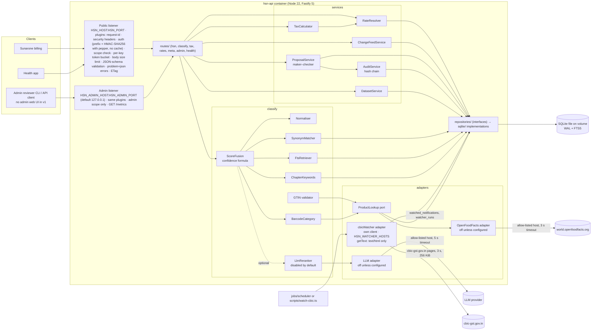
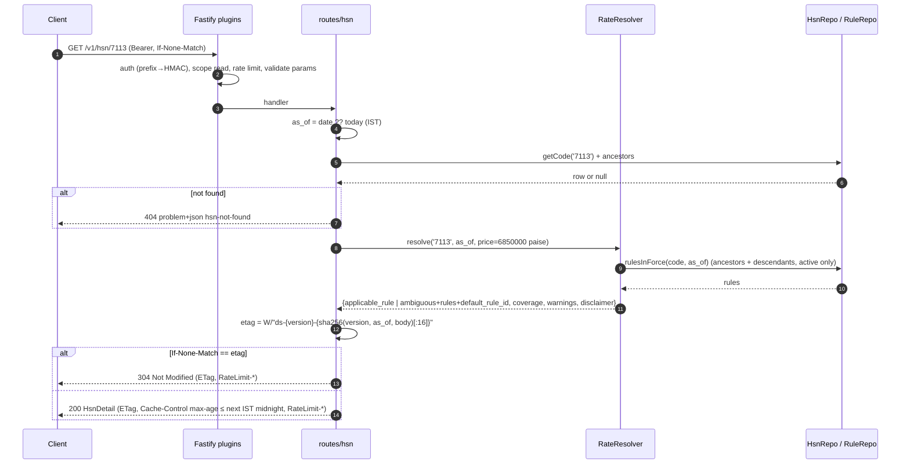
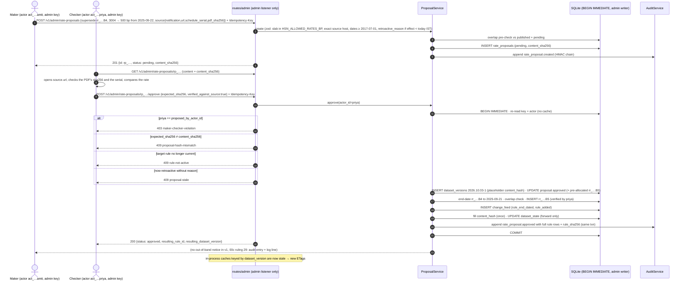
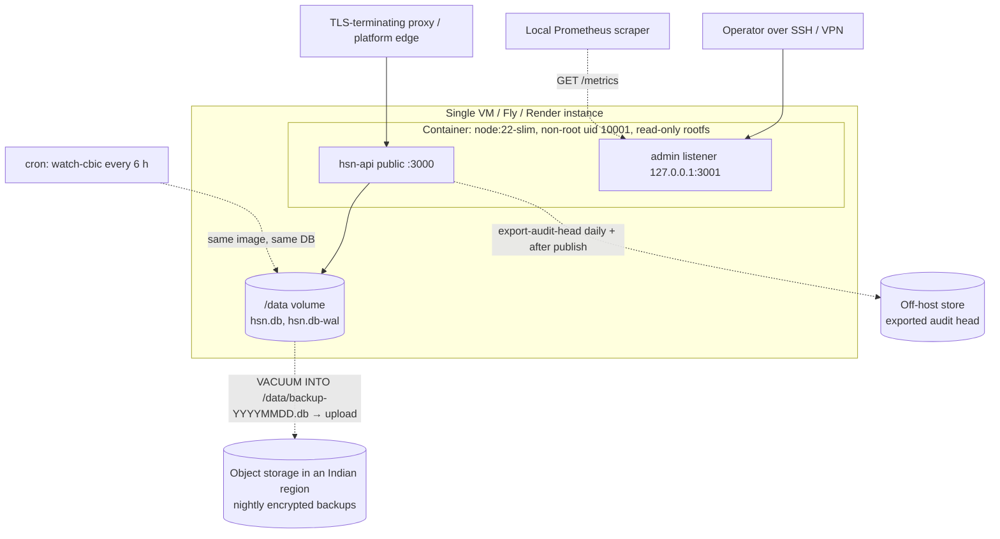

# HSN Rate API — Architecture

Binding inputs: `docs/00-coordinator-decisions.md`, `00b-coordinator-rulings.md`, `00c-coordinator-rulings-round2.md`. Companion files: `openapi.yaml` (contract), `data-model.md` (schema + rate resolution), `ui-and-dx.md`.

Two invariants shape everything below:

1. **Rates come only from `rate_rules`** (human-approved, maker–checker). Classification code paths have read-only access to rates through `RateResolver`; no code in `classify/` or `adapters/` can write a rule or compute a rate.
2. **Classification is a best guess.** It always returns ranked candidates with `confidence`, `confidence_band`, `reasons` and `needs_review`. The confidence score comes from a fixed formula (§5), so every number can be explained from its signals.

## 1. Component view



Outbound HTTP goes through `src/adapters/httpClient.ts` (the single outbound client; accepted deviation from the earlier `lib/http.ts` name, SA-K-16), used only by modules in `adapters/`. Each adapter passes its own exact-host allow-list (`HSN_OUTBOUND_ALLOWLIST` for product lookups and the LLM, `HSN_WATCHER_HOSTS` for the CBIC watcher, which has its own client instance; there is no notifier in v1, 00c ruling 29). `httpClient.ts` connects only to global-unicast addresses (SEC-34; the deny-list includes NAT64, 6to4, `2001::/23`, `3fff::/20`, 198.18/15, 240/4), follows no redirects, ignores proxy environment variables, never disables TLS verification, refuses compressed responses (so the 256 KiB cap always applies to the bytes parsed), caps each caller's timeout (OFF 3 s, LLM 5 s, watcher 3 s), applies per-host minute budgets (OFF 15/min, OBF 10/min, others 10/min) and a global concurrency cap (`HSN_OUTBOUND_QUEUE_MAX`), and never forwards client headers. JSON is read with `getJson`; text only with `getText()`, which requires the client's own `textContentTypes` allow-list (the watcher: `text/html`, `application/xhtml+xml`; the OFF and OBF clients have none) and a utf-8, us-ascii or latin-1/windows-1252 charset. Watcher page URLs are validated at boot (https, default port, no credentials, a path, host in both `HSN_WATCHER_HOSTS` and `HSN_SOURCE_HOSTS`; IP literals refused). The watcher's scheduler lives in `jobs/` and does not import the client itself.

## 2. Request sequences

### 2.1 Lookup — `GET /v1/hsn/7113?unit_price=68500`



### 2.2 Classify by barcode — `POST /v1/classify {barcode}`

```mermaid
sequenceDiagram
  autonumber
  participant C as Client
  participant CL as routes/classify
  participant G as GTIN validator
  participant P as ProductRepo (cache)
  participant A as ProductLookup adapters
  participant N as Name classifier
  participant RR as RateResolver
  C->>CL: POST /v1/classify {barcode:"8901234012345"}
  CL->>G: validate check digit, normalise to GTIN-14
  alt checksum fails
    CL-->>C: 422 invalid-gtin (expected vs actual digit)
  end
  CL->>P: get(gtin)
  alt cache hit, not expired
    P-->>CL: product (or negative-cache "not found")
  else miss / expired
    CL->>A: lookup(gtin) — only adapters enabled by config
    A-->>CL: {name, category} or not_found (timeout → not_found, logged)
    CL->>P: upsert with source + fetched_at (found: 7 d TTL, not found: 1 d TTL)
    Note over CL,A: misses beyond the key's daily outbound cap or the global queue limit<br/>→ product.source lookup_failed (cause key_daily_cap / rate_budget / busy), no outbound call;<br/>adapter errors are cached in memory (15 min; 24 h schema; 2 min budget), never as not_found
  end
  alt no product name and no request name
    CL-->>C: 200 candidates:[] needs_review:true, message (no_signal)
  end
  CL->>N: classify(text = request.name ?? product.name (external), category)
  N-->>CL: ranked candidates with signals + confidence
  loop each candidate
    CL->>RR: resolve(hsn, date, unit_price)
  end
  CL-->>C: 200 ClassifyResponse (product block, candidates, needs_review)
```

If both `name` and `barcode` are sent, the request name is used for text signals and the barcode contributes only the `barcode_category` signal; if the two disagree the top candidate gets reason `barcode_conflict`. If only `barcode` is sent, the text came from external product data, so every candidate is capped at medium with a `review_hint` reason naming the source (§5.4, ruling 22).

### 2.3 Classify by name — `POST /v1/classify {name:"22K gold ring"}`

```mermaid
sequenceDiagram
  autonumber
  participant CL as routes/classify
  participant NZ as Normaliser
  participant SY as SynonymMatcher
  participant FT as FtsRetriever
  participant CK as ChapterKeywords
  participant FU as ScoreFusion
  participant LR as LlmReranker (optional)
  participant RR as RateResolver
  CL->>NZ: "22K gold ring"
  NZ-->>CL: tokens [22k, gold, ring]
  par retrieval
    CL->>SY: match(tokens)
    SY-->>CL: 7113 exact (1.0)
  and
    CL->>FT: MATCH "22k" OR "gold" OR "ring" (levels 4/8, top 10)
    FT-->>CL: 7113 bm25 −7.9, 7117 −4.1, …
  and
    CL->>CK: chapters for tokens
    CK-->>CL: {71}
  end
  CL->>FU: union of candidates + signals
  FU-->>CL: scored, sorted, banded (formula §5)
  opt HSN_LLM_ENABLED and request allow_llm=true and key not llm_opt_out and LLM budget left and top band != high
    CL->>LR: candidates (codes + descriptions only)
    LR-->>CL: permutation of the same codes (anything else discarded)
    Note over CL: llm_used=true only if the permutation was accepted; confidence can only go down
  end
  loop top N
    CL->>RR: resolve(hsn, date, unit_price)
  end
  CL-->>CL: 200 response
```

### 2.4 Rate update with maker–checker



A wrong rule is fixed with action `correct` (ruling 1): the same transaction voids the target and inserts the replacement, which may start on the voided rule's own first day; the feed carries one `rule_corrected` row with both rule ids.

### 2.5 Client cache refresh via change feed

```mermaid
sequenceDiagram
  autonumber
  participant App as Client app (e.g. Sunarone)
  participant Cache as App's local HSN/rate cache
  participant API as hsn-api
  Note over App: on install: since=0
  loop every 15 min (and at app start)
    App->>API: GET /v1/rates/changes?since={stored} (If-None-Match)
    alt 304
      API-->>App: nothing new
    else 200
      API-->>App: changes[], next_since, has_more, feed_epoch
      opt feed_epoch differs from the stored one (server restored)
        App->>Cache: drop all; since=0; store new feed_epoch
      end
      loop each change
        App->>Cache: invalidate cached code c if c.startsWith(affected_prefix) or affected_prefix.startsWith(c)
      end
      App->>App: store next_since (after cache writes commit)
      opt has_more
        App->>API: repeat immediately with next_since
      end
    else 410 feed-window-expired
      App->>Cache: drop all; since=0
    end
  end
  App->>API: GET /v1/hsn/{code} on cache miss (If-None-Match)
```

Clients store `rule_id` + `dataset_version` on each invoice line, so an invoice always shows what rate the API gave at the time, even after a later change.

## 3. Module layout — `server/src`

```
server/src/
  main.ts                  # entrypoint; boot: loadConfig() → openDb() → migrate() → buildApp() → listen
  app.ts                   # buildApp(deps): registers plugins + routes; used by tests (fastify.inject)
  config.ts                # zod env schema; fails closed (exit 1) on any invalid/missing var
  routes/
    health.ts              # /healthz, /readyz
    hsn.ts                 # GET /v1/hsn/search, GET /v1/hsn/:code
    classify.ts            # POST /v1/classify
    tax.ts                 # POST /v1/tax/calculate
    rates.ts               # GET /v1/rates/changes
    meta.ts                # GET /v1/meta/dataset
    admin.ts               # rate-proposals (create/list/get/approve/reject/withdraw), watched-notifications (list/create/triage/resolve), watcher/status, products purge, audit — admin listener only; every write needs Idempotency-Key
    metrics.ts             # GET /metrics (Prometheus text), admin listener only (00c ruling 30)
    schemas/               # JSON schemas (generated from / kept in sync with openapi.yaml)
  services/
    rateResolver.ts        # pure algorithm (data-model.md §3)
    taxCalculator.ts       # paise math, half-up rounding, intra/inter split, cess
    proposalService.ts     # maker–checker, overlap check, publish transaction
    auditService.ts        # RFC 8785 canonical JSON + HMAC-SHA256 chain (HSN_AUDIT_KEY), verify span (verify=true, ≤ 10,000 entries)
    watcher.ts             # CBIC watcher run: fetch, fail-closed parse, notification_key, watched_notifications + watcher_runs, freshness
    changeFeedService.ts
    datasetService.ts      # current version, coverage stats, ETag seed
  repositories/
    types.ts               # HsnRepo, RuleRepo, ProposalRepo, AuditRepo, KeyRepo, ProductRepo, SynonymRepo, FeedRepo, Tx
    sqlite/                # node:sqlite implementations, prepared statements, migrations/*.sql
  classify/
    normalise.ts           # NFKC, lowercase, unit split ("500mg"→"500 mg"), karat ("22 carat"→"22k")
    gtin.ts                # GTIN-8/12/13/14 check digit, normalise to 14
    synonyms.ts            # SynonymMatcher → s_syn
    fts.ts                 # FtsRetriever → bm25, coverage → s_fts
    chapterKeywords.ts     # → s_chap
    barcodeCategory.ts     # category_map → s_bar
    fusion.ts              # confidence formula (classifier.version rules-fts-2.3), bands, reasons, margin penalty, synonym and external-data caps
    coverage.ts            # exactness policy (2.1/2.2): a synonym is exact only when it IS the name; quantity-unit allow-list; generic single words
    accessory.ts           # accessory/packaging qualifier (rules-fts-2.3): accessory after the evidence caps at 0.45 with a hint; packaging keeps contents + hint
    qualifiers.ts          # imitation-jewellery qualifier (plated/imitation/brass/…): 7113 evidence → 7117, other Ch. 71 lowered; never touches rates
    rerank.ts              # optional; enforces "subset of retrieved codes" contract
    pipeline.ts            # orchestrates barcode → product → name → candidates
  adapters/
    productLookup.ts       # port: lookup(gtin) → {name, brand, category} | not_found
    openFoodFacts.ts       # enabled only if HSN_OFF_ENABLED=true; per-key daily cap + global queue limit
    llm.ts                 # port + one implementation; enabled only if HSN_LLM_ENABLED=true and key set; budgets
    cbicWatcher.ts         # fetches the CBIC central/integrated tax rate pages with its own client (HSN_WATCHER_HOSTS, getText text/html); no PDF parsing;
                           # linear tokenizer with per-row caps, hidden rows skipped; parse isolated in cbicParseWorker.ts (worker thread, 64 MB, 2 s)
    httpClient.ts          # the only outbound fetch: per-caller allow-list, global-unicast-only IPs, no redirects, capped timeouts, per-host budgets, no compression, 256 KiB cap
  lib/
    problem.ts             # problem+json builder, error type registry (type URI ↔ status ↔ title)
    auth.ts                # key parsing (hsk_<prefix8>_<secret43>), HMAC-SHA256 with pepper[pepper_id], timingSafeEqual, scope guard; no key cache
    rateLimit.ts           # one token bucket per key (600 tokens/min: refill 10/s, burst 100); costs: classify 5, tax 1+floor(lines/50), else 1
    etag.ts                # weak ETag over (dataset_version, as_of IST, body) + If-None-Match; max-age capped at next IST midnight
    money.ts               # INR ↔ paise, bp math, half-up rounding
    dates.ts               # IST "today", date validation
    ids.ts                 # prefixed ULIDs
    log.ts                 # pino via Fastify; redacts Authorization, key material; input_hash = HMAC-SHA256(HSN_LOG_KEY, normalised name)
  db/
    open.ts                # openDb(): WAL, foreign_keys=ON, trusted_schema=OFF; three connections: read-only, cache writer, admin writer
    migrate.ts             # base schema + src/db/migrations.ts steps in a transaction (v3 watcher, v4 pepper_id, v5 bound guards, v6 citation_note, v7 keyed-row confirmation); refuses a newer schema
    seed.ts                # `npm run seed`: validated seed files → first dataset version (rules unverified; refused in production)
  jobs/
    scheduler.ts           # in-process timers: watcher runs when HSN_WATCHER_ENABLED (every HSN_WATCHER_INTERVAL_MIN, first after 30 s), idempotency purge, products eviction (oldest fetched_at first); imports adapters, not adapters/httpClient directly
scripts/                   # operator CLIs (admin writer connection; npm scripts of the same names, 00c ruling 31): seed.ts, create-key.ts, bootstrap-admins.ts,
                           # export-audit-head.ts, verify-audit.ts, rotate-feed-epoch.ts, disable-actor.ts, ack-restore.ts, import-dataset.ts,
                           # eval-classifier.ts (npm eval), watch-cbic.ts (cron; exit 0 ok, 1 config, 2 failed, 3 freshness alert)
  (services/integrity.ts   # state-to-audit cross-check, run at boot, in verify-audit and import-dataset)
  (services/restoreGuard.ts# restore detection against the MAC'd high-water-mark sidecar HSN_STATE_HWM_FILE)
```

Dependency rule (checked by a small test that greps imports): `routes → services|classify → repositories/types`; only `repositories/sqlite` and `db/` import `node:sqlite`; only modules in `adapters/` import `adapters/httpClient.ts`; `jobs/` may import adapters but not the client; nothing in `classify/` imports `proposalService`, `RuleRepo` write methods, or `taxCalculator`.

## 4. Deployment view



- **One process, one SQLite file, two listeners.** WAL mode; writes (admin approvals, product cache upserts, `last_used_at`, idempotency rows) are rare and short. Expected read load (thousands of rps for cached lookups) fits one Node process. Admin routes are served only on `HSN_ADMIN_HOST:HSN_ADMIN_PORT` (default `127.0.0.1:3001`, reached over SSH or VPN), never on the public listener (ruling 25). Prometheus `GET /metrics` is served on the admin listener only (`HSN_METRICS_HOST` / `HSN_METRICS_PORT` are dropped, 00c ruling 30).
- **Single-process limitation (SA-D-13).** The same process holds the key peppers (`HSN_KEY_PEPPER` or `HSN_KEY_PEPPERS`), `HSN_AUDIT_KEY`, `HSN_LOG_KEY` and any LLM key; an RCE in a parsing dependency reaches all of them. Mitigations: minimal dependencies, the three DB connections, the off-host audit head. A separate admin process is the next step if the threat model changes.
- **Config:** `HSN_` prefix everywhere: `HSN_DB_PATH`, `HSN_PORT`, `HSN_ADMIN_HOST`, `HSN_ADMIN_PORT`, `HSN_TRUST_PROXY`, `HSN_KEY_PEPPERS` (or `HSN_KEY_PEPPER`), `HSN_AUDIT_KEY`, `HSN_LOG_KEY`, `HSN_OUTBOUND_ALLOWLIST`, `HSN_WATCHER_ENABLED`, `HSN_WATCHER_HOSTS`, `HSN_OFF_ENABLED`, `HSN_LLM_ENABLED`, `HSN_LLM_PROVIDER`, `HSN_LLM_API_KEY`, `HSN_RATE_LIMIT_PER_MIN`, `HSN_ALLOWED_RATES_BP`, `HSN_SOURCE_HOSTS`, `HSN_LOG_LEVEL` (full list: `02-TRD.md` §8). Validated by zod at boot; unknown `NODE_ENV`, missing DB path, `HSN_LLM_ENABLED=true` without a key, or production behind a known platform proxy with `HSN_TRUST_PROXY` unset → refuse to start.
- **Readiness:** `/readyz` checks `db`, `migrations` (at head), `fts5`, `dataset`, plus results computed once at boot: `dataset_integrity` (content hash re-verified), `audit_integrity` (whole HMAC chain and the state-to-audit cross-check) and `state_continuity` (no unacknowledged restore, valid sidecar). Publicly it returns only `{status}`; the per-check detail goes to the log.
- **Migrations** run at boot inside a transaction; the app refuses to start on a newer schema than it knows.
- **Backups:** nightly `VACUUM INTO` snapshot, encrypted, to object storage in an Indian region; the exported audit head (`scripts/export-audit-head.ts`) is copied off the host daily. `HSN_STATE_HWM_FILE` lives on a different volume and backup set (required in production). Restore: replace the DB file from a backup and start; the server detects it, rotates `feed_epoch`, alerts and fails readiness until `npm run ack-restore` and a restart (`scripts/rotate-feed-epoch.ts` stays for a manual rotation); runbook in `server/README.md`.

**Path to Postgres** (when multi-instance or heavy write load is needed): implement `repositories/postgres/*` against the same interfaces (`data-model.md` §6 mapping), move rate limiting to Redis via the `lib/rateLimit.ts` interface, run N stateless containers behind the LB, migrate data with a one-off export (`rate_rules`, `audit_log` with the HMAC chain verified after import). No route, service or classify code changes.

## 5. Classification confidence scoring

### 5.1 Normalisation
NFKC → lowercase → replace `&` with `and` → split digits from units (`500mg` → `500 mg`) → karat forms (`22 kt`, `22 carat`, `22ct`, `22 karat`) → `22k` → strip punctuation except `-` inside words → collapse whitespace. **Quantity tokens** (`<number> <unit>` with unit in g, kg, mg, ml, l, pcs, pack) are dropped for synonym and FTS matching but kept for chapter keywords. Example: `"Paracetamol 500mg Tablet"` → tokens `[paracetamol, 500, mg, tablet]`; synonym/FTS tokens `[paracetamol, tablet]`.

### 5.2 Candidate generation
Union of: every code hit by a synonym; top 10 FTS hits (levels 4 and 8); the `category_map` prefix of the barcode product, if any. If an 8-digit code and its 4-digit heading are both candidates, keep the higher-scoring one.

**Where the text comes from.** If the request has `name`, all text signals use the request name and the barcode contributes only `s_bar`. If the request has only `barcode`, the text signals use the product name from the cache or adapter: that text is **external product data** (Open Food Facts is publicly editable) and the external-data cap below applies (ruling 22).

### 5.3 Signals (each in [0, 1], per candidate)

| Signal | Symbol | Weight | Applicable to the request when | Definition |
|---|---|---|---|---|
| Synonym hit | `s_syn` | **0.50** | at least one curated synonym matched the text (for any candidate) | 1.0 if a `primary` synonym phrase appears as a contiguous token run in the text and maps only to this code; 0.7 if the phrase's tokens all appear but not contiguously, **or** the phrase maps to more than one code (contested); 0.3 if only a `related` synonym matches; else 0. Max over matching synonyms. |
| FTS rank | `s_fts` | **0.20** | always | `0.5 · (bm25_c / bm25_best) + 0.5 · coverage_c`, where bm25 values are SQLite's (negative; ratio ∈ (0,1]) and `coverage_c` = fraction of query tokens found in the code's description + keywords. 0 if not an FTS hit. |
| Chapter keyword | `s_chap` | **0.15** | always | 1 if any token (incl. unit tokens) maps via `chapter_keywords` to the candidate's chapter, else 0. |
| Barcode category | `s_bar` | **0.15** | the barcode resolved to a product whose category is in `category_map` | 1.0 if the candidate starts with the mapped prefix (same heading or deeper); 0.5 if same chapter only; 0 otherwise. |

**Exactness policy (`rules-fts-2.1`, validator R2; `rules-fts-2.2`, SA-K3-01/04; `classify/coverage.ts`).** On top of the `s_syn` table above: a primary, contiguous, uncontested phrase scores 1.0 only when it **is** the name, i.e. after removing its tokens nothing remains but quantities (a number, optionally with an allow-listed unit, or a karat value), pack words, dosage forms and function words. Otherwise a contained phrase scores 0.7, a one-word phrase inside a longer name 0.3, and single generic words (tablet, shirt, ring, chain, oil, …) are never exact. Barcode brand words never count. The imitation-jewellery qualifier (`classify/qualifiers.ts`) moves 7113 evidence to 7117 (capped at 0.7) and lowers other Chapter 71 evidence ×0.4. **Accessory / packaging qualifier (`rules-fts-2.3`, `classify/accessory.ts`):** an accessory word (stand, holder, cover, case, charger, cable, mount, guard, …, "screen guard", "tempered glass", "back cover"; not "sleeve") that follows a candidate's own evidence or is linked to it by "for" caps that candidate at 0.45 (low) with a review hint, unless the word is the candidate's own evidence ("phone charger" keeps 8504); packaging words (box, hamper, packaging, container, basket) keep the contents' candidates with a review hint. It only lowers scores and never adds a candidate. The worked examples in §5.5 are fixture values of the formula; live answers on the shipped seed are in `03-app-flow.md`.

### 5.4 Formula (ruling 2 as amended by ruling 22)

```
A        = {fts, chap}
           ∪ {syn} if any curated synonym matched the text
           ∪ {bar} if the barcode product's category is in category_map
raw_c    = Σ_{i∈A} w_i · s_i(c)  /  Σ_{i∈A} w_i      # weights renormalised over A: 0.35, 0.50, 0.85 or 1.00
gap      = raw_top − raw_second        (raw_second = 0 if single candidate)
penalty  = max(0, 0.10 − gap) / 2      # applied to the top candidate only; ≤ 0.05
conf_c   = clamp(raw_c − penalty_c, 0, 1)
syn cap  : if s_syn(c) < 1.0 → conf_c = min(conf_c, 0.84)            (no reason code; conf < raw shows it)
ext cap  : if the text came from external product data → conf_c = min(conf_c, 0.84)   reason review_hint (names the source)
close    : if conf_top − conf_second < 0.10 → conf_top = min(conf_top, 0.84), reason close_runner_up
llm gate : if the re-ranker's first choice ≠ deterministic first choice → every conf_c = min(conf_c, 0.84)
drop     : candidates with conf_c < 0.10 are removed; at most max_candidates (≤ 5) returned
weak     : if the best remaining conf < 0.30 → keep the rest, every band = low, needs_review = true, response `message`
empty    : candidates = [] only when nothing reaches 0.10 (needs_review = true, `message`)
confidence = round(conf_c, 2)
band       = high if ≥ 0.85; medium if ≥ 0.60; else low
needs_review (candidate) = band ≠ high
needs_review (response)  = top candidate band ≠ high, or no candidates
```

What this means, honestly:
- **`high` needs an exact curated synonym hit on text the client sent.** A partial or contested synonym, FTS plus chapter keywords, or a barcode category can each reach at most `medium` (0.84).
- **Without any synonym**, strong FTS plus chapter agreement reaches medium (the ceiling is 0.84; raw 1.00 is possible because the weights are renormalised over `{fts, chap}`). A weak FTS hit alone stays low.
- **A barcode-only request is never `high`** (ruling 22): its text came from crowd-edited data, so even a perfect synonym and category match is capped at medium with a `review_hint` reason naming the source. To reach `high`, the client sends `name` as well, and an exact curated synonym on that name must hit the same code.
- The margin penalty and the close-alternative cap both apply: a top candidate whose lead is under 0.10 loses up to 0.05 and is capped at medium.
- **Order and recomputation.** The response's `candidates` order is the ranking (after any re-rank, confidences are clamped to be non-increasing); `scoring` gives the applicable set A and the denominator, and `signals`/`reasons` give each term.
- **Rule hint (ruling 5).** An exact curated synonym on the caller's name may carry `rule_hint` (a rule `condition_code`, e.g. `nil_rate_list`). If the candidate's resolution is ambiguous and exactly one rule has that code, the resolver selects it (warning `selected_by_hint`) and the candidate carries `rule_hint`. It never comes from external product data or from a partial, contested or related synonym, and it does not change the band.

Why this is explainable: each candidate returns its raw `signals` (a signal outside A is `null`) and a `reasons[]` entry per non-zero term, so `confidence` can be recomputed by hand from the response. Each `reasons[]` entry is `{code, detail, weight}`, where `weight` = w_i·s_i/Σ_{A}w (negative for the margin penalty, 0 for informational reasons and caps). Weights are constants in `classify/fusion.ts`, versioned as `classifier.version` (the formula dates from `rules-fts-2.0`; the current version is `rules-fts-2.3`, whose changes are in the exactness policy above); any change bumps the version. The LLM re-ranker only reorders within the candidate list and can only lower confidence.

### 5.5 Worked examples (recomputed under §5.4; match `openapi.yaml`)

Signal values are illustrative (they depend on the curated data); the arithmetic is exact. Ruling 2 requires one realistic input per band through each path; the empty cells are impossible by design (ruling 22).

| Path | Input | Candidate | A (Σw) | s_syn | s_fts | s_chap | s_bar | raw | cap | conf | band |
|---|---|---|---|---|---|---|---|---|---|---|---|
| Synonym | "22K gold ring" | **7113** | syn,fts,chap (0.85) | 1.0 | 0.62 | 1 | null | (0.50+0.124+0.15)/0.85 = 0.911 | none | **0.91** | high |
| | | 7117 | | 0 | 0.41 | 1 | null | (0.082+0.15)/0.85 = 0.273 | | 0.27 | low |
| Synonym | "Paracetamol 500 mg tablet" | **3004** | syn,fts,chap (0.85) | 0.7 (contested) | 0.55 | 1 | null | (0.35+0.11+0.15)/0.85 = 0.718 | (syn cap, not binding) | **0.72** | medium |
| | | 2924 | | 0.3 (related) | 0.20 | 0 | null | (0.15+0.04)/0.85 = 0.224 | | 0.22 | low |
| Synonym | "Dry fruits gift box 500 g" (related synonym "dry fruits" → 0813) | **0813** | syn,fts,chap (0.85) | 0.3 | 0.40 | 1 | null | (0.15+0.08+0.15)/0.85 = 0.447 | | **0.45** | low |
| | | 0802 | | 0 | 0.30 | 1 | null | (0.06+0.15)/0.85 = 0.247 | | 0.25 | low |
| FTS + chapter | "Knitted cotton T-shirt" (no synonym) | **6109** | fts,chap (0.35) | null | 0.83 | 1 | null | (0.166+0.15)/0.35 = 0.903 | syn cap → 0.84 | **0.84** | medium |
| | | 6205 | | null | 0.45 | 0 | null | 0.09/0.35 = 0.257 | | 0.26 | low |
| FTS + chapter | "Mobile phone stand" (no synonym, no chapter keyword) | **8517** | fts,chap (0.35) | null | 0.30 | 0 | null | 0.06/0.35 = 0.171 | | **0.17** | low (weak: `message`) |
| | | 3926 | | null | 0.12 | 0 | null | 0.024/0.35 = 0.069 | | dropped (< 0.10) | — |
| FTS + chapter | — | — | | | | | | | `high` impossible without an exact synonym | | |
| Barcode only | GTIN 8901234012345 → "Glucose Biscuits 250 g", `en:biscuits` | **1905** | all (1.00) | 1.0 | 0.71 | 1 | 1.0 | 0.50+0.142+0.15+0.15 = 0.942 | ext cap → 0.84 | **0.84** | medium |
| Barcode only | GTIN → "Masala Munchies 30 g", `en:salty-snacks` (not mapped) | **2106** | fts,chap (0.35) | null | 0.25 | 0 | null | 0.05/0.35 = 0.143 | ext cap (not binding) | **0.14** | low (weak: `message`) |
| Barcode only | GTIN → product with category `en:biscuits` but no usable name | **1905** | fts,chap,bar (0.50) | null | 0 | 0 | 1.0 | 0.15/0.50 = 0.300 | ext cap (not binding) | **0.30** | low |
| Name + barcode | `{name: "Glucose biscuits", barcode: 8901234012345}` | **1905** | all (1.00) | 1.0 | 0.71 | 1 | 1.0 | 0.942 | none | **0.94** | high |

All gaps are ≥ 0.10, so no margin penalty applies in these examples. The previous version of this table (weights always over `{syn, fts, chap}`) gave the barcode-only biscuits 0.94 `high`; that is now 0.84 `medium` by ruling 22.

### 5.6 What the LLM re-ranker may do (if enabled)
Input (AI-10/AI-22, as implemented in `classify/rerank.ts`): one JSON object with `product_text` (normalised, ≤ 200 chars), `product_category` (the external category tag, in its own delimited field, ≤ 100 chars, or null; SA-D-26) and `candidates[]` (code + official description). Both text fields are untrusted data and are covered by the AI-16 injection corpus and the AI-22 payload snapshot. Output must be the JSON object `{ "ranking": [code, …] }`, an exact permutation of the input codes; anything else (new code, rate, text) is discarded and logged, and the deterministic order is used. It is skipped when the deterministic top is already `high`, and runs only when `HSN_LLM_ENABLED=true`, the request sends `allow_llm: true` (default false), the key is not `llm_opt_out`, and the LLM call budgets (`HSN_LLM_CALLS_PER_MIN`, `HSN_LLM_CALLS_PER_DAY`) are not spent. The response reports `llm_used`; `/v1/meta/dataset` discloses whether an LLM is configured and which provider. It never sees or returns rates.

## 6. Cross-cutting

- **Errors:** every thrown `AppError` carries a registered problem `type`; unknown errors → 500 with `request_id` only. See `ui-and-dx.md` §1.
- **Logging:** one JSON line per request: `request_id`, `client_request_id` (if sent), route pattern, status, latency, `key_id`, `tenant`, `dataset_version`. Classify requests log only `input_hash` = HMAC-SHA256(`HSN_LOG_KEY`, normalised name) (SEC-62/63, SA-D-18), never the raw or truncated name.
- **Rate limiting:** one token bucket per key (`rate_limit_per_min`, default 600: refill 10 tokens/s, burst capacity ⌈600/6⌉ = 100 tokens). Costs: `POST /v1/classify` 5, `POST /v1/tax/calculate` 1 + floor(lines/50), everything else 1. `RateLimit-Limit` (600), `RateLimit-Remaining`, `RateLimit-Reset`, `RateLimit-Cost` and `RateLimit-Policy` (`600;w=60;burst=100`) on every authenticated response (ruling 14).
- **Caching:** in-process LRU of resolved rule sets keyed by `(dataset_version, code, as_of)`; the `unit_price` filter is applied after the cache, so varying prices cannot evict other tenants' entries. Invalidated wholesale on publish.
- **Security headers:** set in an `onSend` hook (no extra dependency): `Strict-Transport-Security`, `Referrer-Policy: no-referrer`, `Content-Security-Policy: default-src 'none'; frame-ancestors 'none'`, `Cache-Control` per the TRD §11 table, `X-Content-Type-Options: nosniff`.
